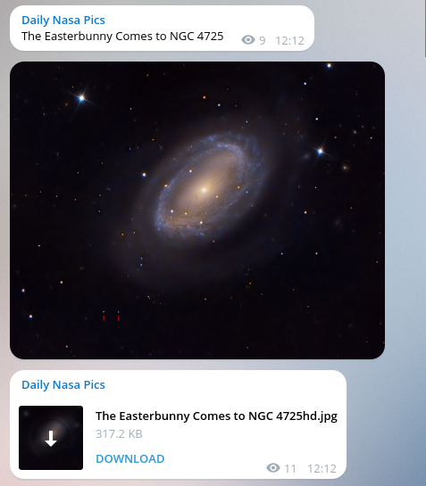
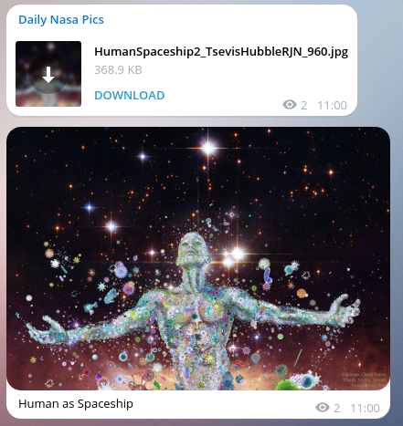

## Daily Nasa Pics

Every day NASA publishes a photo through its open API.
Since I really like those images and I usually share them with my friends I decided to create this bot.

Once a day it downloads the APOD JSON, then sends to a Telegram channel: the title, the image as a photo (or the video as a video), the HD image as a document, and the explanation.

## Pictures




## Like it?

[Join the telegram channel](https://telegram.me/dailynasapictures) **and star this repo!**

## Usage

This runs as a [Trigger.dev](https://trigger.dev) scheduled task at 08:00 Europe/Madrid.

```bash
pnpm install
cp .env.example .env
pnpm dev
```

Set these environment variables locally and in the Trigger.dev dashboard (Prod):

- `TELEGRAM_BOT_TOKEN`
- `TELEGRAM_CHANNEL` (`@channelusername` or a numeric ID)
- `NASA_API_KEY` (optional, defaults to `DEMO_KEY`)
- `TRIGGER_SECRET_KEY` (local CLI only)
- `TRIGGER_PROJECT_REF` (Trigger.dev project ref, local CLI only)

Deploy with `pnpm deploy`. The daily schedule only runs in production. Add the bot as a channel admin with Post Messages.

## License

MIT
